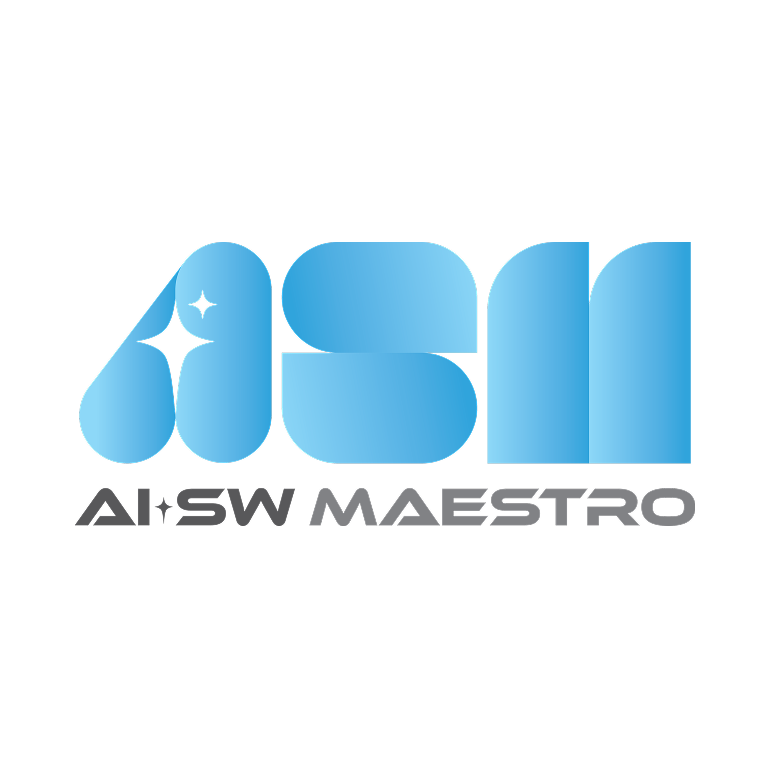
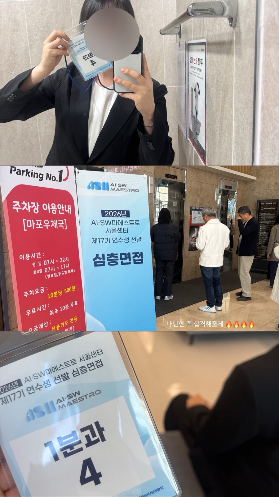
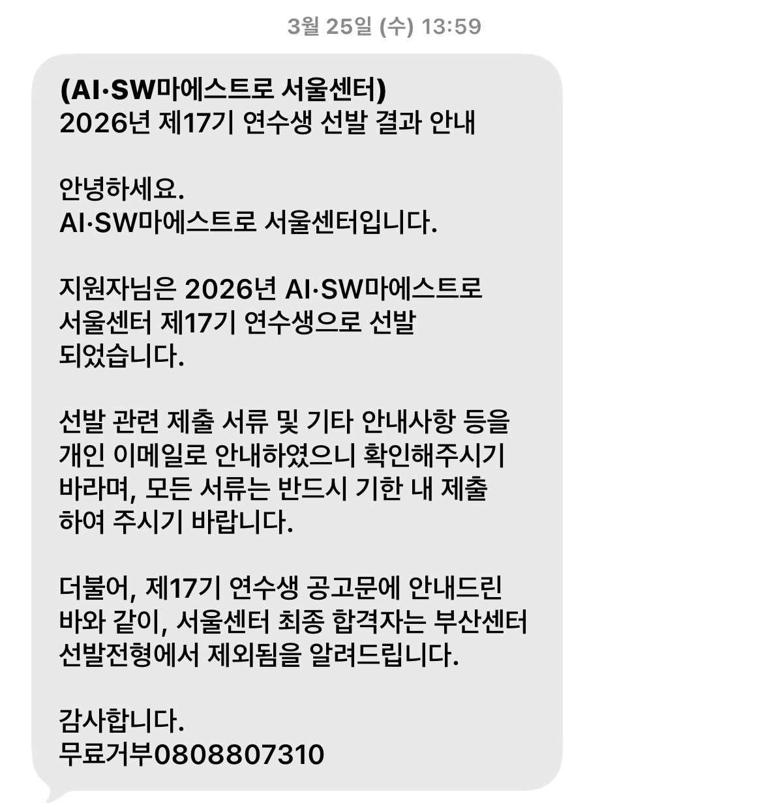
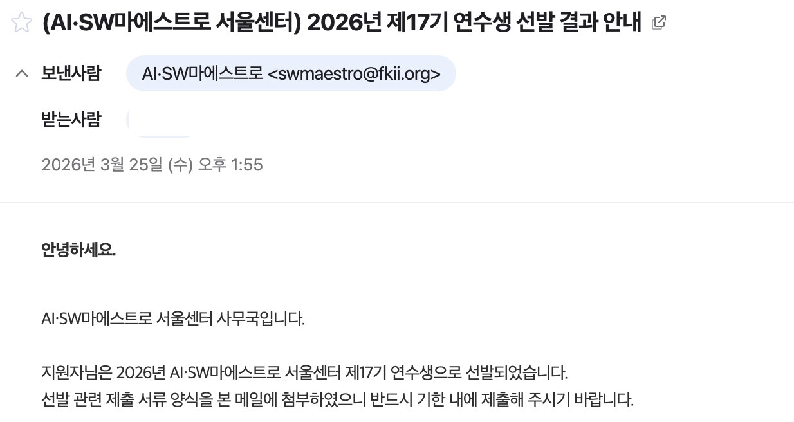


## <strong>AI·SW 마에스트로 서울센터 17기에 합격했다!!!</strong>

<strong>1차</strong> - 서류 전형, <strong>2차</strong> - 1차 코딩테스트, <strong>3차</strong> - 2차 코딩테스트, <strong>4차</strong> - 심층면접의 과정을 거쳐 합격하게 되어서,

기록해두면 소마를 준비하시는 분들께도, 미래의 나에게도 도움이 많이 될 것 같아 후기를 써보게 되었다!

---

## <strong>서류전형</strong>

서류 전형은 필수 2문항 선택 1문항이었고, 아래와 같았다.

> 1. (*필수) [자기소개] AI 및 SW분야의 전문성을 키우기 위해 몰입했던 경험과 도전이 무엇인지, 또한 이러한 성장과정을 통해 얻은 배움은 무엇인지를 서술하여 주시기 바랍니다.(최소 400자, 최대 1000자 입력가능)
>
> 2. (*필수) [연수계획서] AI·SW마에스트로 과정 참여를 통해 어떠한 프로젝트를 수행하고 싶은가요? 해당 프로젝트를 수행하기 위한 계획과 이루고자 하는 목표가 무엇인지 구체적으로 서술하여 주시기 바랍니다.(최소 400자, 최대 1000자 입력가능)
>
> 3. (선택) AI 및 SW대회 수상 등 증빙이 가능한 경우 서술하여 주시기 바랍니다. (대회명 / 수상내역 / 수상일자 / 수여기관 / 증빙서(첨부파일))

서류 전형 기간은 2월 11일까지였는데, 다음 학기에 ICT 인턴쉽 지원을 미리 해뒀었어서 1번 문항은 빠르게 작성할 수 있었다. 나는 프로젝트 경험이 많지는 않아서, 3-2에 산학프로젝트에서 진행했던 프로젝트로 1번 문항을 작성하였다!

2번 문항은 산학프로젝트에서 진행했던 프로젝트를 디벨롭시킨 느낌으로 작성했는데, 올해부터 AI소마가 된 만큼..! AI 관련 기능 계획을 구체화하여 작성하였다. 면접 때 물어보실까봐 면접 직전에 관련 공부 엄청 했었다 ㅜㅜ

3번 문항은 학교에서 받은 상장들을 증빙할 방법을 모르겠어서 그냥 안 냈다,,

소마 서류 전형은 대충 쓰지만 않으면 붙는다는 말이 있지만,, 나처럼 상상도 못했는데 면접까지 갈 수도 있으니, 꾸밈없이 솔직하게 작성하는 것이 가장 중요한 것 같다!

---

## <strong>1차 코딩테스트</strong>

소마 코테는 내 인생 첫 코테였다!! 그만큼 너무 떨리고 설렜다!!

알고리즘 4문제와 SQL 1문제가 나온다고 해서, 2주 정도 프로그래머스에서 SQL 고득점 Kit를 시간 날 때마다 엄청~~~~~~ 풀었다.

풀면서 모르는 SQL 함수들을 노션에 정리해두고, 어려웠던 문제랑 코드도 작성해두면서 계속해서 봤던 것 같다.

그 결과 SQL 문제는 잘 풀었고! 오히려 믿고있던 알고리즘 문제가 너무 긴장해서 문제도 잘 안 읽히고 잘 안 풀렸던 것 같다ㅋㅋㅋ (몇 솔인지는 비밀..) 사실 예전 1차컷이 4솔이라고 해서 난 당연히 떨어질 줄 알았는데..... 🤩🤩🤩

---

## <strong>2차 코딩테스트</strong>

솔직히 2차 코테는 당연히 떨어질 거라고 생각해서 맘편히 봤다ㅋㅋ

이번에도 SQL문제에 자신이 있다고 착각하고 제일 먼저 풀기 시작했는데..... 어...... 과감히 포기했다. 2차는 확실히 2차인듯.

1번 문제가 굉장히 흥미로워서 종이에 열심히 그림그려가며 시간을 오래 들여서 풀었던 기억이 있다!

2차때는 2솔?1.5솔? 정도 한 것 같다!

코테 시작할 때랑 다르게 예상보다는 잘 한 것 같아서, 오 이정도면 붙을지도?! 하는 생각으로 결과 나오길 기다렸다ㅋㅋㅋㅋ

---

### <strong>코테 요약</strong>

1차 코테 알고리즘 문제에는 DFS/BFS나 DP같이 알고리즘을 이용한 문제는 안 나왔던 것 같고, 2차 때는 알고리즘을 사용한 문제가 나왔다! (오래돼서 기억이,, 아닐 수도 있음!)

1차는 거의 기본 구현 느낌? 근데 긴장해서 문제가 잘 안 읽히는 거 주의하기!! 프로그래머스로 많이 풀어보기!!

난 지금까지 PS를 백준으로만 했어서, 1차 코테 때 프그 UI가 어색해서 문제가 너무너무 안 읽혔다!! 다들 주의!!!

---

## <strong>심층 면접</strong>

다시 생각해도 너무너무....너무.....떨린다........

우선 소마 면접은 <strong>PT 3분 + 질문 12분</strong> 으로 진행돼서, 면접 4일? 정도 전까지 포트폴리오를 제출해야 한다!

난 활동한 게 그렇게 많지 않았기에, 하나의 활동이라도 최대한 자세히 쓰려고 노력했다.

대망의 면접!!! 을 가기 위해 고양시에서 지원해주는 면접 정장 무료 대여 사업을 통해 정장도 대여하였다! 다들 이거 완전 추천!!

면접은 목~일 동안 진행했는데, 나는 목요일 2시를 배정받았다. 잠을 너무 조금 자도 머리가 안 돌아서 면접 때 대답을 잘 못할 것 같아, 오전 10시에 일어났다. PT 대본 외우면서 아점먹고, 출발하고나니 너무 떨려서 아무것도 못했다!!!

도착해서는 대본을 외워햐 하는데, 같이 면접보는 분들도 계시니 더 실감이 나서 떨려서 아무것도 못하고, 화장실가서 옷매무새 정리하다가 면접장으로 들어갔다..!

5:5 면접이었고, 면접자마다 번호가 있었는데 나는 4번이었다!

우선 가서 자리에 앉았는데, 내 바로 앞에 계신 면접관님 표정이 너무 무서워서,,, 앉자마자 쫄아있었다.

1번부터 PT를 하는데, 1번분이 정말,,,, 로봇같이 말을 너무 잘 하셨다,,, 3번 분까지도 정말 PT를 잘 하셨고, 내 차례가 왔다!!

집에서 작성했던 대본은 총 15줄 정도였는데, 긴장해서 말이 점점 느려지고, 다음 말이 기억이 안 나서 좀 생각을 하다보니, 진행했던 프로젝트 소개를 하기도 전에 2분이나 지나버렸다!!!! 결국 프로젝트 소개를 하다가 시간이 다 되어 자리로 들어갔다ㅋㅋㅋㅋㅋ

이때 정말 망했다는 생각이 들어서 바로 밖으로 나가고 싶었다ㅋㅋㅋㅋ 그래도 오히려 처음에 망쳐버리니까, '난 정말 면접을 경험하기 위해 왔다!' 라는 마인드로 면접을 비교적 편하게 볼 수 있던 것 같다!!!

이후엔 면접관분들이 돌아가시면서 지원자 한명한명 질문을 하셨다. 분과별로/면접관별로 차이가 큰 것 같은데, 우리 분과 면접관분들은 지원자 한명한명 질문 1개씩은 꼭 해주셨다! 질문도 들어보니 분과별로/면접관별로 차이가 크던데, 우리 분과는 거의 포폴/자소서 기반으로 질문해주셨고, 공통 질문으로 AI사용법이나 인성 질문이 많이 있었다!

난 모르는 것도 최대한 열심히 대답하려고 노력했고, 합격 후에 면접을 복기해봤는데 나름 대답 잘한 것 같기도..? 라는 생각이 들었다ㅋㅋㅋ

그치만 면접 당일에는 발표를 망쳤다는 생각에 100% 떨어졌다고 생각했다ㅋㅋㅋ 아래는 인스타 비계에 올린 스토리이다ㅜㅜㅋㅋㅋ

---

## <strong>최종 합격</strong>

아무 생각 없이 지내던 수요일!!! (참고로 이번 기수는 수요일 2시 결과 발표가 국룰이었다)

합격 연락이 왔다!!! 학교에 있었는데, 화장실가서 방방 뛰고 기뻐했던 기억이 있다ㅋㅋㅋㅋ

너무너무 운좋게 붙은 것 같고, 붙여주신 것에 감사하면서 열심히 소마 생활 중이다 !!!

현재는 4월 3일 워크숍도 다녀왔고, 정말 오래 걸렸던 팀빌딩도 마무리했고, 엑스퍼트 매칭도 했고, 멘토님도 2분 구했고, 멘토님 1분 매칭만 남은 상태이다! 특강도 열심히 시간 날 때마다 듣고 있다!

아직 소마 한 달차지만, 멘토님들도 너무 대단하신 분들밖에 안 계시고, 엑스퍼트/연수생분들 모두 대단하시고 좋은 분들이다.

다들 기회가 된다면 꼭 소마를 경험해봤으면 좋겠다!!

