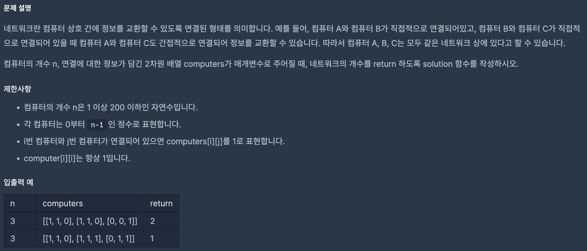


<https://school.programmers.co.kr/learn/courses/30/lessons/43162>

🔗 [프로그래머스](https://school.programmers.co.kr/learn/courses/30/lessons/43162)



```python
def solution(n, computers):
    visited = [False] * n
    answer = 0

    def dfs(current):
        visited[current] = True

        for neighbor, connected in enumerate(computers[current]):
            if connected and not visited[neighbor]:
                dfs(neighbor)

    for computer in range(n):
        if not visited[computer]:
            dfs(computer)
            answer += 1

    return answer
```

